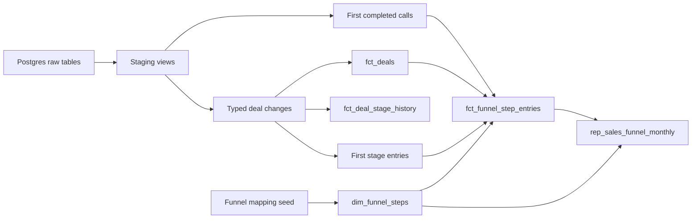

# Pipedrive sales funnel

A small dbt project that rebuilds deal lifecycles from a Pipedrive change log
and produces a monthly sales-funnel report:

```text
public_pipedrive_analytics.rep_sales_funnel_monthly
```

The report has one row per month and funnel step, including zero-count rows.

## Run it

Requirements: Docker Desktop, Python 3.11+, and pip.

```bash
docker compose up -d db
docker compose run --rm data_loader

python -m venv .venv
source .venv/bin/activate
pip install -r requirements.txt

dbt build --profiles-dir .
```

## Data flow



Staging cleans source data, intermediate models apply business logic, and marts provide reusable facts for reporting.

## Key findings from EDA

The queries behind these checks are in `analyses/source_data_audit.sql`.

| Finding | Why it matters / design choice |
|---|---|
| No deal snapshot | Rebuild current state and stage history from the change log. |
| 1,995 `deal_id`s but 2,000 creations | Recover logical lifecycles with a sample-specific clock fingerprint; production needs an immutable source ID. |
| Only eight activity deal IDs overlap with the change log | Keep calls as a separate population instead of dropping them in a deal join. |
| Stages can repeat or move backwards | Preserve full history, but count only the first entry per funnel step. |

## Funnel rules

The ordered mapping lives in `seeds/funnel_steps.csv`:

- step 1 is deal creation (`add_time`);
- steps 2–9 are the first observed entries into stages 2–9;
- step 2.1 is the first completed `meeting` activity;
- step 3.1 is the first completed `sc_2` activity;
- repeated entries do not increase the count;
- skipped stages are not inferred;
- missing month/step combinations are returned as zero.

The two call steps come from the independent activity population. Their counts
should not be used to calculate conversion from the surrounding deal stages.

## Main model grains

| Model | Grain |
|---|---|
| `fct_deals` | One recovered deal lifecycle |
| `fct_deal_stage_history` | One observed stage entry |
| `fct_activities` | One activity |
| `fct_funnel_step_entries` | One entity's first entry into one funnel step |
| `rep_sales_funnel_monthly` | One month and funnel step |

## Scaling notes

- Keep full refreshes for the current dataset: simple, reliable, and cheap.
- At scale, materialize `int_pipedrive__deal_changes` and rebuild only changed deal instances and report months.
- Add a stable event ID and ingestion timestamp first; tune indexes or partitioning from real query patterns, not assumptions.

## Tests

`dbt build` validates model grains, relationships, lifecycle logic, and the final report contract. Known source quirks remain visible as warnings without blocking the build.
